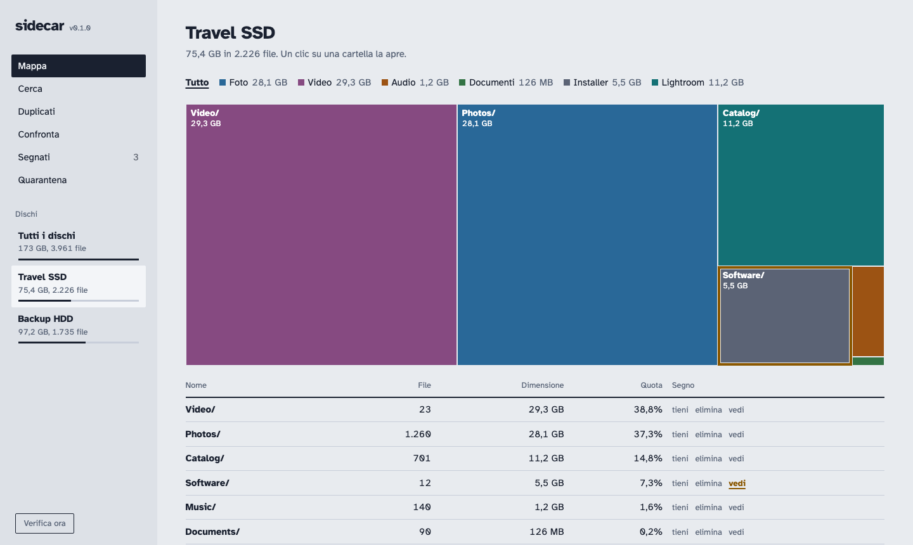

# Sidecar

A catalog that lives on each of your external disks. Open it in the browser to see what is on
the disk, where the space goes, what is duplicated and what you can let go of. The same index is
a plain SQLite file, so scripts and LLMs can search it too.



Plug in several disks and Sidecar shows them side by side, compares folders across disks and
finds the files that exist twice. It runs on your own computer; nothing is sent anywhere.

- **One program, nothing to install first.** A single executable per system (macOS, Linux,
  Windows), with the app inside. No Python, no runtime, no packages.
- **One catalog per disk.** `<disk>/.sidecar/index.db` describes that disk and only that disk. It
  travels with the disk, and so do the programs: plug the disk into another computer and open it.
- **The disk is the truth.** The index is a snapshot. When Sidecar starts it re-checks every
  plugged-in disk and tells you what changed by hand since last time.
- **Safe clean-up.** Files you mark for deletion are *moved* to a quarantine folder on the same
  disk, not deleted. You can restore them. Space is freed only when you empty the quarantine and
  type a confirmation word. Sidecar refuses to remove the last copy of a duplicated file.
- **Search inside files.** Names, plus the text of text files, code and PDFs.
- **Made to be read by LLMs.** An MCP server and a documented schema.

## Install

1. Download the build for your system from the
   [releases page](https://github.com/sim186/disk-sidecar/releases). To use the same disk on
   several kinds of computer, download `disk-sidecar-…-all-systems.zip` and unzip it.
2. **Double click the program you downloaded.** Your browser opens and asks where to install Disk
   Sidecar: choose a connected disk and press Install. It copies itself there and scans the disk. No
   terminal needed. (Already installed disks are offered too, as Update.)

   If you prefer the terminal, the same thing from the command line (this also offers to scan):

   ```sh
   ./sidecar-darwin-arm64 install /Volumes/MyDisk        # Mac, Apple silicon
   ./sidecar-linux-amd64 install /media/me/MyDisk        # Linux
   sidecar-windows-amd64.exe install E:\                 # Windows
   ```

   The installer copies every build it finds next to it into `<disk>/.sidecar/bin/`, so the disk
   opens on every system you downloaded. Run it again later, from a newer download, to update: it
   leaves your index, marks, quarantine and snapshots alone. `--dry-run` shows what it would do,
   `--label "Name"` names the disk, `--scan` scans without asking, `--from DIR` adds builds from
   another folder.
3. To open the catalog later, double click **Open Sidecar** in the root of the disk
   (`Open Sidecar.command` on Mac and Linux, `Open Sidecar.bat` on Windows; if macOS blocks it, right
   click and choose Open). The hidden `.sidecar` folder has the same launchers. Your browser opens a
   page served from your own computer, `http://127.0.0.1:8765`.

**Updates.** The app asks GitHub, at most once a day, whether a newer release exists, and shows a line with
a link if so. It sends nothing about you or your disks, and never installs by itself. Turn it off with
`sidecar serve --no-update-check` or `SIDECAR_NO_UPDATE_CHECK=1`. A disk plugged in while the app runs is
offered a sidecar too (`--no-watch` turns that off).

The builds are not code-signed, so macOS (Gatekeeper) and Windows (SmartScreen) may warn the first
time. On a Mac, if a downloaded file is refused, run `xattr -d com.apple.quarantine <file>`.

**From source** (needs Go, nothing else): `./build.sh` builds every system into `dist/`;
`./build.sh native` builds only the one you are on.

## Using it

- **Map**: folders as a map sized by space, coloured by file type. Click a folder to open it,
  click a type in the legend to filter. The disks in the left column filter everything.
- **Search**: names, and the contents of text, code and PDF files (PDFs need `pdftotext` from
  poppler). Searching inside files needs the server, so open the catalog with `open-sidecar`.
- **Duplicates**: groups of identical files. Run `sidecar hash` once to turn "probably the same"
  (same name and size) into "identical" (same SHA-256).
- **Compare**: pick two folders, even on different disks: what is only in A, only in B, in both,
  and whether one is entirely redundant.
- **Tidying piles**: in the spirit of Marie Kondo, hold each file or folder and ask *does it spark joy?*
  Next to it, sort it into *keep*, *spark joy?* (still deciding) or *let go*. A choice on a folder covers what is
  inside. Piles are saved in the index of the disk the file lives on.
- **Farewell box**: where the "let go" pile waits to be released; see below.

On the disk, `.sidecar/sidecar` (`sidecar.cmd` on Windows) runs the right build for the computer
you are on: `./sidecar serve | scan | hash | merge | mcp | version | install`.

### Copying

Next to every file and folder, **copy to…** copies it to a folder on any connected disk, the same one too.
In *Tidying piles*, "Copy the “keep” pile to…" does it for everything you kept. The originals are never touched.
Each file is written under a temporary name, read back from the destination and compared (SHA-256) before it
gets its final name; its modification time is kept; nothing is ever overwritten; if one file of a folder
fails, none of that folder is kept. The copies appear in the catalog at once. To *move*, copy first and then
put the original in the *let go* pile: because the copy is now a proven duplicate, Sidecar lets the original go
(but never both copies). Empty folders are not copied.

### This computer

The system disk is not an external disk, so Sidecar does not offer it when it finds one. To catalog it, choose
**This computer** in the install dialog ("Install on a disk…"), or run `sidecar install ~` (Windows:
`sidecar install %USERPROFILE%`). That installs into `~/.sidecar` and scans your home folder, leaving out
`Library`, `AppData` and hidden folders. On the system disk Sidecar only ever changes files inside a user
folder: moving to the farewell box, restoring and copying are refused on the operating system, programs, other
users' folders, the home folder itself and the folders where programs keep their data. Marks are notes
and still work everywhere. Disks mounted under `/Volumes`, `/media`, `/mnt` or another drive letter are not
affected.

### Freeing space

1. Put files or folders in the *let go* pile.
2. In **Tidying piles**, choose "Thank them and move the “let go” pile to the farewell box". A progress bar shows the move. The files go to
   `<disk>/.sidecar/_quarantine/<date>/…` (a rename on the same disk, so it is instant) and leave
   the index. Nothing is deleted yet.
3. In the **Farewell box** you can bring any item back. When you are sure, "Release for good…"
   deletes everything in the box after you type `DELETE`. This is the only step that cannot be
   undone, and the only one that frees space.

The server refuses, whatever the page asks: paths outside a disk, files or folders that changed
since the last scan, symlinks, anything on a read-only snapshot, and moving every remaining copy of
a duplicated file across the plugged-in disks. Every action is appended to the disk's `log.csv`.

### Several disks, and computers you cannot plug in

Start Sidecar from any disk, or from anywhere. It looks for `.sidecar/index.db` on every mounted
disk (`/Volumes` on Mac, drive letters on Windows, `/media`, `/mnt`, `/run/media` on Linux; add more
with `--mounts DIR`) and shows them together.

To recognise copies across disks, give each disk the hashes of the files whose size also occurs on
the other (only those files are read):

```sh
/Volumes/A/.sidecar/sidecar hash --db /Volumes/A/.sidecar/index.db --also-match /Volumes/B/.sidecar/index.db
/Volumes/B/.sidecar/sidecar hash --db /Volumes/B/.sidecar/index.db --also-match /Volumes/A/.sidecar/index.db
```

A computer you cannot plug in (a laptop at home, say): scan it there into a small file,

```sh
sidecar scan C:\Users\me --db laptop.db --source "Laptop"
sidecar hash --db laptop.db --also-match <copy of a disk's index.db>
```

and drop `laptop.db` into `<disk>/.sidecar/peers/`. It appears as a read-only snapshot with its
date. Its copies do not count as safe copies when Sidecar protects the last copy of a file.

## For LLMs and scripts

```sh
claude mcp add disk-sidecar -- /Volumes/MyDisk/.sidecar/sidecar mcp
```

Tools: `disk_summary`, `search_files`, `search_content`, `get_file_info`, `list_folder`,
`find_duplicates`. Or open `index.db` read-only with any SQLite client; the schema and example
queries are in `internal/assets/disk/README.md`, which the installer puts next to the index.

## Versions and updates

Sidecar follows [semantic versioning](https://semver.org/). The version is in
`internal/assets/VERSION`, the history in [CHANGELOG.md](CHANGELOG.md), and each release is a git
tag (`v0.2.0`) that the release workflow turns into downloadable builds.

- Update: install again from a newer download (`sidecar install /Volumes/MyDisk`).
- The index has its own `schema_version`. A newer Sidecar opens older indexes; an older Sidecar
  refuses to touch an index written by a newer one, and tells you to update.
- To release: change `internal/assets/VERSION`, add an entry to the changelog, tag `vX.Y.Z` and push.

## Good to know

- **exFAT** is the filesystem to use for a disk shared by Mac and Windows. It has no journal:
  unplugging during a scan or a move can corrupt the index. A backup, `index.db.bak`, is kept next
  to it; keep another copy somewhere else now and then.
- NTFS disks are read-only on a Mac without a third-party driver.
- Copying with Finder or `cp` onto exFAT/NTFS creates `._name` files; Sidecar ignores them.
- The index holds file names and extracted text. Treat it like the data it describes.
- Text is extracted from text files, code and PDFs, at most 256 KB per file, and not from build
  and dependency folders (`node_modules`, `.git`, `build`, `vcpkg_installed`, …): those are still
  found by name.
- Skipped on purpose: `$RECYCLE.BIN`, `System Volume Information`, `.Spotlight-V100`, `.Trashes`,
  `.fseventsd`, `.TemporaryItems`, `.sidecar`, `.DS_Store`, `Thumbs.db`, `desktop.ini`.

## Development

```sh
go vet ./... && go test ./...
```

The tests build the program and run it against fake disks: scanning and incremental updates,
duplicates across disks, merging, installing and updating, and the server (disks found together,
changes made by hand, marks routed to the right disk, search inside files, the quarantine and every
rule that protects your files). The page's dependencies (sql.js, MIT; Atkinson Hyperlegible, SIL
OFL) are vendored in `internal/assets/web/vendor`, so it works offline. SQLite is
[modernc.org/sqlite](https://pkg.go.dev/modernc.org/sqlite), pure Go, which is why no C compiler is
needed and every system builds from a single machine.

What has and has not been checked:

- The tests pass on macOS (Apple silicon), also with the race detector, and the workflow in
  `.github/workflows` has run them on GitHub: they pass on macOS and Linux. The first run on Windows
  failed on a real bug (`--mounts` was ignored there), fixed in 0.2.1; that fix has not been through
  GitHub yet. The Intel Mac build starts under Rosetta but has not run the tests.
- Nobody has opened the catalog on Windows or Linux by hand: `open-sidecar.bat`, drive-letter
  discovery and Windows paths have only the automated tests behind them.
- The page was checked with a headless browser, not by a person clicking through every dialog.

## Licence

[MIT](LICENSE).
